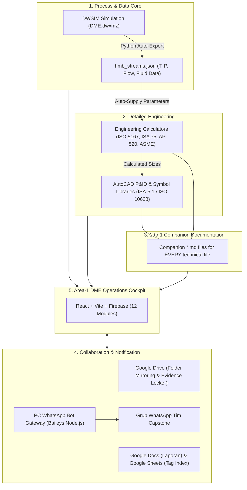
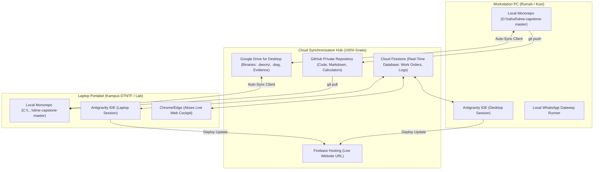

# MASTER BLUEPRINT: EKOSISTEM DATABASE TERPADU & OPERATIONS COCKPIT
**Proyek Capstone:** Front-End Engineering Design (FEED) Pabrik Dimethyl Ether (DME)  
**Program Studi:** Teknik Fisika, Departemen Teknik Nuklir dan Teknik Fisika (DTNTF FT UGM)  
**Tahun Akademik:** 2026/2027  
**Dokumen Kontrol:** DOC-CAPSTONE-DME-2026-MASTER-001  
**Status Anggaran:** 100% Bebas Biaya (Rp 0 Selamanya, Berbasis FOSS & Akun UGM)  
**Versi:** 1.0 (Definitive Master Concept)

---

## DAFTAR ISI
1. [BAB I: Visi Arsitektur & Prinsip Single Source of Truth (SSOT)](#bab-i-visi-arsitektur--prinsip-single-source-of-truth-ssot)
2. [BAB II: Struktur Hirarki Monorepo Terpadu](#bab-ii-struktur-hirarki-monorepo-terpadu)
3. [BAB III: Arsitektur Integrasi Multi-Platform (5 Pilar Sistem)](#bab-iii-arsitektur-integrasi-multi-platform-5-pilar-sistem)
   - [3.1 Integrasi Simulator Proses Kimia (DWSIM)](#31-integrasi-simulator-proses-kimia-dwsim)
   - [3.2 Integrasi Google Workspace (Drive, Docs, Sheets, Calendar)](#32-integrasi-google-workspace-drive-docs-sheets-calendar)
   - [3.3 Integrasi Drafting AutoCAD & Validasi Tag](#33-integrasi-drafting-autocad--validasi-tag)
   - [3.4 Integrasi WhatsApp Grup Berbasis PC (Local Gateway Baileys)](#34-integrasi-whatsapp-grup-berbasis-pc-local-gateway-baileys)
   - [3.5 Infrastruktur Cloud & Database (Firebase Spark Plan)](#35-infrastruktur-cloud--database-firebase-spark-plan)
4. [BAB IV: Spesifikasi Komprehensif 12 Fitur Website Area-1 Cockpit](#bab-iv-spesifikasi-komprehensif-12-fitur-website-area-1-cockpit)
5. [BAB V: Standar Baku Companion Markdown (.md System)](#bab-v-standar-baku-companion-markdown-md-system)
6. [BAB VI: Peta Langkah Kerja Terurut (Master Execution Roadmap)](#bab-vi-peta-langkah-kerja-terurut-master-execution-roadmap)
7. [BAB VII: Tata Kelola Tim (RACI) & Jaminan Bebas Biaya (Zero-Cost)](#bab-vii-tata-kelola-tim-raci--jaminan-bebas-biaya-zero-cost)
8. [BAB VIII: Konsep Sinkronisasi Multi-Device (Desktop PC ⟷ Laptop Continuity)](#bab-viii-konsep-sinkronisasi-multi-device-desktop-pc--laptop-continuity)

---

## BAB I: Visi Arsitektur & Prinsip Single Source of Truth (SSOT)

Pembangunan sistem Master Database Capstone ini dirancang untuk menyatukan seluruh artefak rekayasa proses, instrumentasi, otomasi kendali, keselamatan fungsional, analisis ekonomi, dan manajemen proyek ke dalam satu ekosistem tanpa redudansi manual.



### Prinsip Pokok Desain:
1. **Rule of Twin Files (Companion `.md` 1-to-1)**: Setiap file teknis (`.dwg`, `.dxf`, `.csv`, `.lin`, `.dwxmz`) wajib memiliki file kembar berformat `.md` dengan nama sama persis. File markdown berfungsi sebagai panduan pengoperasian mandiri (SOP, dasar teori, rumus matematika, dan batasan operasional).
2. **Automated Cross-Discipline Pipeline**: Perubahan data pada simulasi proses DWSIM otomatis mengalir ke kalkulator ukuran katup/orifis, indeks instrumen di Google Sheets, dan verifikasi tag pada gambar AutoCAD P&ID.
3. **Audit Readiness (DTNTF FT UGM Standard)**: Seluruh artefak proyek terikat pada rubrik evaluasi Capstone DTNTF 2026 dan siap dikompilasi secara otomatis ke bundel sidang Stage-Gate 1 sampai 4.

---

## BAB II: Struktur Hirarki Monorepo Terpadu

Seluruh kode program website, aset CAD, kalkulator rekayasa, file simulasi, dan skrip otomasi disatukan ke dalam satu direktori kerja root:  
📂 **`D:\rahul\dme-capstone-master`**

```text
D:\rahul\dme-capstone-master/
├── 00_CORE_GUIDELINES/                   # Standar Industri & Pedoman Akademik DTNTF
│   ├── Panduan_Capstone_DTNTF_2026.pdf
│   ├── Panduan_Capstone_DTNTF_2026.md    # Ekstrak tahapan, rubrik, dan matriks penilaian
│   ├── ISA_5_1_Instrumentation_Symbols.md
│   ├── ISO_10628_Flowsheets_Summary.md
│   ├── API_520_Sizing_Selection_PRD.md
│   └── ASME_PTC_19_3_Thermowell_Design.md
│
├── 01_PROCESS_SIMULATION_DWSIM/          # Jantung Simulasi Proses Kimia
│   ├── simulation_files/
│   │   ├── DME.dwxmz                     # File simulasi proses dehidrasi metanol (NRTL)
│   │   └── DME.md                        # Companion MD: Model termodinamika & asumsi reaksi
│   ├── exported_data/
│   │   ├── hmb_streams.json              # Ekspor otomatis data aliran S-101 s.d. S-204
│   │   └── equipment_energy_balance.json # Neraca energi pompa, reaktor, heater, & kolom
│   └── scripts/
│       └── export_dwsim_hmb.py           # Skrip otomatisasi ekstraksi stream DWSIM
│
├── 02_ENGINEERING_CALCULATORS/           # Kalkulator Rekayasa Berbasis CSV & Python
│   ├── CALC_ISO5167_Orifice.csv
│   ├── CALC_ISO5167_Orifice.md           # SOP sizing orifice plate, rumus beta ratio
│   ├── CALC_ISA75_ControlValve.csv
│   ├── CALC_ISA75_ControlValve.md        # SOP sizing katup kendali, perhitungan Cv & Fl
│   ├── CALC_API520_PSV.csv
│   ├── CALC_API520_PSV.md                # SOP safety valve, skenario fire & blocked outlet
│   ├── CALC_ASME_Thermowell.csv
│   ├── CALC_ASME_Thermowell.md           # SOP verifikasi getaran frekuensi wake & bending stress
│   ├── CALC_TeknoEkonomi_NPV.csv
│   └── CALC_TeknoEkonomi_NPV.md          # Model CAPEX, OPEX, NPV, IRR, dan analisis sensitivitas
│
├── 03_CAD_AND_PID_LIBRARIES/             # Master Template & Library Blok Simbol AutoCAD
│   ├── templates/
│   │   ├── DME_Master_Template.dwt       # Template gambar etiket UGM format A1 & A3
│   │   ├── DME_Master_Template.md
│   │   ├── acad_dme.lin                  # Definisi garis sinyal instrumen & jalur pipa proses
│   │   └── acad_dme_lin.md
│   ├── symbol_libraries/
│   │   ├── ISO10628_Equipment.dxf / .md  # Simbol pompa, reaktor, kolom, heat exchanger
│   │   ├── ISA51_Instruments.dxf / .md   # Simbol field/panel bubble, transmitter, DCS/SIS
│   │   ├── ISA52_LogicGates.dxf / .md    # Gerbang logika AND, OR, timer, flip-flop ESD
│   │   ├── ISA54_LoopDiagrams.dxf / .md  # Blok terminal strip & marshalling loop diagram
│   │   ├── APIRP551_Hookup.dxf / .md     # Simbol perpipaan hook-up impuls & manifold
│   │   ├── ISA101_HMI.dxf / .md          # Grafis HMI high performance display
│   │   ├── ISA62443_Security.dxf / .md   # Arsitektur cyber security zona & conduit
│   │   └── DME_PID_Master_Legend.dxf / .md
│   └── scripts/
│       └── generate_libraries.js         # Skrip Node.js generator DXF otomatis
│
├── 04_INSTRUMENTATION_ISA20/             # Master Index & Form Spesifikasi Lembar ISA-20
│   ├── Master_Instrument_Index_DME.csv
│   ├── Master_Instrument_Index_DME.md    # Kamus penomoran tag dan aturan sinkronisasi Sheets
│   ├── datasheets/
│   │   ├── DS_ISA20_Temperature_Transmitter.csv / .md
│   │   ├── DS_ISA20_Pressure_Transmitter.csv / .md
│   │   ├── DS_ISA20_Control_Valve.csv / .md
│   │   └── DS_ISA20_Coriolis_Flowmeter.csv / .md
│
├── 05_SAFETY_AND_CONTROL/                # Dokumen Keselamatan Fungsional & Filosofi Kontrol
│   ├── Cause_and_Effect_Matrix_ESD.csv
│   ├── Cause_and_Effect_Matrix_ESD.md    # Matriks logika interlock trip SIL 2/3
│   ├── FDS_Control_Narrative_ISA506.md   # Narasi loop kontrol reaktor & distilasi
│   ├── Master_Alarm_Database_ISA182.csv
│   └── Master_Alarm_Database_ISA182.md   # Prioritisasi alarm (High-High, High, Trip limit)
│
├── 06_COLLABORATIVE_WORKSPACE/           # Hub Tautan & Cache Google Workspace
│   ├── google_workspace_registry.json    # Registry ID & URL resmi Docs, Sheets, & Drive
│   ├── mirrors/                          # Cache offline dokumen Google Docs & Sheets
│   └── Google_Workspace_Guide.md         # SOP kolaborasi cloud tim
│
├── 07_FINAL_DELIVERABLES/                # Produk Resmi Gambar & Laporan Siap Sidang
│   ├── drawings/
│   │   ├── PID_DME_Area100_Reaction.dwg / .pdf / .md
│   │   ├── PID_DME_Area200_Purification.dwg / .pdf / .md
│   │   └── Layout_3D_PlotPlan_DME.dwg / .pdf / .md
│   └── reports/
│       ├── FEED_Book_Volume_1_Basis_Desain.pdf / .md
│       ├── FEED_Book_Volume_2_Instrumentasi_Kontrol.pdf / .md
│       └── FEED_Book_Volume_3_Tekno_Ekonomi_Safety.pdf / .md
│
├── apps/
│   └── operations-cockpit/               # Web Application (Area-1 DME Cockpit)
│       ├── src/
│       │   ├── components/views/         # 12 Modul Tampilan (Termasuk 3 Modul Baru)
│       │   ├── context/                  # AppContext & State Sinkronisasi Firestore
│       │   ├── types/                    # TypeScript Data Interfaces
│       │   └── data/initialData.ts       # Database Awal Tim & Master Deliverables
│       ├── package.json
│       └── vite.config.ts
│
├── tools/
│   ├── whatsapp-bot/                     # Local WhatsApp Gateway (Baileys Node.js)
│   │   ├── index.js                      # Express API + Baileys multi-device socket
│   │   ├── auth_info/                    # Sesi login WA (hanya scan QR sekali)
│   │   └── package.json
│   ├── export_dwsim_hmb.py               # Ekstraktor stream DWSIM ke JSON/CSV
│   ├── validate_tags.py                  # Validator konsistensi tag P&ID vs Sheets vs FDS
│   └── build_manifest.js                 # Parser metadata companion .md untuk website
│
└── README.md                             # Panduan orientasi repositori monorepo
```

---

## BAB III: Arsitektur Integrasi Multi-Platform (5 Pilar Sistem)

### 3.1 Integrasi Simulator Proses Kimia (DWSIM)
* **File Acuan**: [`d:\rahul\autocad\DME.dwxmz`](file:///d:/rahul/autocad/DME.dwxmz).
* **Karakteristik Model**:
  - Reaksi dehidrasi metanol fase gas: $2\text{CH}_3\text{OH} \rightarrow \text{CH}_3\text{OCH}_3 + \text{H}_2\text{O}$ ($\Delta H_r = -23.4\text{ kJ/mol}$, eksotermik).
  - Termodinamika: NRTL (*Non-Random Two-Liquid*) dengan koreksi fase uap Ideal/RK.
* **Alur Ekstraksi Headless**:
  1. Skrip Python `tools/export_dwsim_hmb.py` mengekstrak data dari `tmp1118.xml` di dalam arsip `.dwxmz`.
  2. Data termodinamika diekspor ke `exported_data/hmb_streams.json`:
     - Aliran Inlet: Suhu ($T$), Tekanan ($P$), Laju Alir ($kg/h$).
     - Properti Fisika: Densitas ($\rho$), Viskositas ($\mu$), Kapasitas Panas ($C_p$).
  3. Data ini menjadi suplai otomatis bagi:
     - Kalkulator ukuran orifis `CALC_ISO5167_Orifice` (mencegah salah input data fluida).
     - Modul `DwsimStreamView` pada website cockpit untuk tinjauan live tim instrumen & safety.

---

### 3.2 Integrasi Google Workspace (Drive, Docs, Sheets, Calendar)
* **Akun Pengguna**: Akun resmi mahasiswa UGM (`@mail.ugm.ac.id`) — **100% Gratis**.
* **Struktur Folder Google Drive (Mirrored 1-to-1)**:
  - `Google Drive / CAPSTONE_DME_AREA1/`
    - `00_CORE_GUIDELINES/`
    - `01_PROCESS_SIMULATION/`
    - `02_ENGINEERING_CALCULATORS/`
    - `04_INSTRUMENT_INDEX_SHEETS/`
    - `06_LIVING_REPORTS_GDOCS/`
    - `07_FINAL_DELIVERABLES_PDF/`
    - `08_WORK_ORDERS_EVIDENCE/` (Folder otomatis: `/WO-001/`, `/WO-002/`, dst.)
    - `09_STAGE_GATES_SUBMISSIONS/`
* **Mekanisme Kolaborasi**:
  - **Google Sheets**: Menjadi media kolaborasi hidup untuk Master Instrument Index & IO List. Perubahan di Sheets disinkronkan ke file CSV lokal via Google Sheets Export API.
  - **Google Docs**: Menjadi media penulisan draf laporan bab 1-4 dan FDS. Web Cockpit menyediakan tombol direct link serta *cache reader*.
  - **Google Calendar & Meet**: Jadwal bimbingan rutin dengan dosen pembimbing terhubung ke kalender dan room Google Meet.

---

### 3.3 Integrasi Drafting AutoCAD & Validasi Tag
* **CAD Engine**: Terhubung ke Antigravity via MCP `aec-pilot` dan skrip otomasi `generate_libraries.js`.
* **Auto-Plotting Pipeline**:
  - File DWG/DXF dari lembar kerja P&ID diproses secara batch dan diekspor ke format PDF resolusi tinggi (standar lembar A1/A3).
  - File PDF disimpan di `07_FINAL_DELIVERABLES/drawings/` dan di-mirror ke Google Drive `/Deliverables/PDF_Plots/`.
  - Website cockpit menyajikan modal *In-App PDF Viewer* sehingga dosen pembimbing dapat memeriksa revisi gambar tanpa perlu menginstal AutoCAD.
* **Cross-Validation Tag Engine (`tools/validate_tags.py`)**:
  - Skrip mendeteksi teks blok instrumen pada AutoCAD P&ID (misal: `TIC-101`, `FCV-101`, `PSV-102`).
  - Membandingkan daftar tag tersebut dengan Master Instrument Index di Google Sheets dan dokumen FDS ISA-5.06.
  - Jika ditemukan tag yang tidak terdaftar (*phantom tag*) atau salah kode penomoran, dashboard memunculkan notifikasi peringatan inkonsistensi.

---

### 3.4 Integrasi WhatsApp Grup Berbasis PC (Local Gateway Baileys)
* **Teknologi**: Node.js + `@whiskeysockets/baileys` (Open-source, Multi-Device Web Protocol).
* **Biaya**: **100% Gratis (Rp 0)**, tanpa biaya langganan bulanan vendor pihak ketiga.
* **Karakteristik & Performa**:
  - Sangat ringan: Hanya mengonsumsi memori RAM $\approx 40\text{ MB}$ (tanpa browser Chromium headless).
  - Kunci sesi disimpan di `tools/whatsapp-bot/auth_info/`. Anda hanya perlu melakukan **scan QR code satu kali** dari WhatsApp di HP. Saat PC dimatikan dan dihidupkan kembali, bot langsung terhubung otomatis.
* **Triggers Notifikasi ke Grup WhatsApp Tim**:
  1. *Penugasan Work Order Baru / Kritis*: Mengirimkan notifikasi berisi kode WO, PIC utama, deskripsi tugas, deadline, dan link folder Google Drive.
  2. *Peringatan Deadline $H-2$*: Mengingatkan tugas yang jatuh tempo dalam $\le 48\text{ jam}$.
  3. *Ringkasan Action Items MoM*: Mengirimkan poin arahan dan tugas revisi dosen pembimbing seusai rapat asistensi.
* **Dual-Mode Fail-Safe**:
  - Jika bot lokal di PC sedang aktif $\rightarrow$ Pesan terkirim otomatis secara instan.
  - Jika bot lokal di PC sedang nonaktif $\rightarrow$ Tombol di cockpit otomatis beralih membuka tautan WhatsApp Web (`wa.me`) dengan pesan yang telah siap terformat, tinggal tekan Enter.

---

### 3.5 Infrastruktur Cloud & Database (Firebase Spark Plan)
* **Paket**: **Firebase Spark Plan (Free Tier)** — Tanpa kartu kredit.
* **Alokasi Kuota Gratis**:
  - Firebase Authentication: Email & Password login tidak terbatas.
  - Cloud Firestore: 50.000 pembacaan/hari dan 20.000 penulisan/hari (Kebutuhan aktual tim 5 orang hanya $\approx 300\text{--}500$ pembacaan/hari).
  - Firebase Hosting: Penyimpanan 10 GB dan transfer data 360 MB/hari.
* **Integritas Data**: Menggunakan dokumen Firestore `projectData/area1` dengan snapshot listener real-time dan aturan keamanan `firestore.rules`.

---

## BAB IV: Spesifikasi Komprehensif 12 Fitur Website Area-1 Cockpit

```text
┌────────────────────────────────────────────────────────────────────────┐
│                   AREA-1 DME OPERATIONS COCKPIT                        │
├─────────────────┬─────────────────────┬────────────────────────────────┤
│ GOVERNANCE      │ ENGINEERING HUB     │ DTNTF ACADEMIC                 │
├─────────────────┼─────────────────────┼────────────────────────────────┤
│ 1. Homepage     │ 6. DWSIM Stream Hub │ 11. Logbook Presensi UGM       │
│ 2. Work Orders  │ 7. Workspaces       │ 12. Stage-Gate & Sidang Rubrik │
│ 3. Schedule     │ 8. Standards        │                                │
│ 4. Team RACI    │ 9. Master Library   │                                │
│ 5. Weekly MoM   │ 10. Google Workspace│                                │
└─────────────────┴─────────────────────┴────────────────────────────────┘
```

### Rincian Modul:

1. **Homepage (`HomepageView.tsx`)**:
   - Executive dashboard memuat status tender, banner darurat, progress akumulatif 10 deliverable, kecepatan audit (*speed audit %*), dan widget pertemuan terdekat dengan dosen pembimbing.
2. **Work Orders (`WorkOrdersView.tsx`)**:
   - Sistem tiket penugasan kerja formal berbasis bukti (*evidence-based*). Mendukung filter board/list, status alur kerja (`Ditugaskan`, `Dikerjakan`, `Blocked`, `Diajukan`, `Selesai`), integrasi folder Google Drive, dan tombol blast WhatsApp grup.
3. **Schedule & Critical Gantt (`ScheduleView.tsx`)**:
   - Timeline interaktif 16 minggu masa Capstone DTNTF FT UGM. Mengidentifikasi jalur kritis (*Critical Path*) dan menghubungkan penyelesaian tugas secara otomatis dengan penutupan tiket Work Order.
4. **Team RACI & Directory (`TeamRaciView.tsx`)**:
   - Matriks akuntabilitas (Responsible, Accountable, Consulted, Informed) untuk setiap bab laporan dan gambar teknik, dilengkapi kartu profil anggota tim dan tombol tautan cepat WhatsApp & Email UGM.
5. **Weekly MoM & Asistensi (`WeeklyMoMView.tsx`)**:
   - Pencatat notulensi resmi bimbingan mingguan dosen. Mendukung auto-spawning action items menjadi tiket Work Order dan ekspor format resmi kop surat UGM ke Google Docs.
6. **Process Simulation Hub (`DwsimStreamView.tsx`) — *[Modul Baru]*:
   - Viewer tabel aliran massa & energi (HMB) hasil simulasi DWSIM. Menyajikan suhu, tekanan, laju alir, fraksi uap, dan komposisi mol untuk insinyur instrumentasi dan safety tanpa perlu membuka aplikasi DWSIM.
7. **Workspaces & Deliverables (`WorkspacesView.tsx`)**:
   - Pelacak 10 artefak deliverable utama FEED dari draft hingga berstatus *ACC Final Pembimbing*, dilengkapi modal preview gambar teknik P&ID PDF di browser.
8. **Standards & Guidelines (`StandardsView.tsx`)**:
   - Pusat referensi kepatuhan standar industri (ISA, ISO, API, ASME) dan regulasi keselamatan K3 pabrik kimia, terhubung langsung ke dokumen PDF lengkap di Google Drive.
9. **Master Library & Markdown Reader (`MasterLibraryView.tsx`) — *[Modul Baru]*:
   - Penjelajah file monorepo interaktif dan pembaca dokumen companion `.md` dengan dukungan rendering formula matematika KaTeX dan validasi integritas file kembar.
10. **Google Workspace Hub (`GoogleWorkspaceView.tsx`) — *[Modul Baru]*:
    - Pintu gerbang terpadu menuju living documents Google Docs laporan antara, Google Sheets Master Instrument Index, dan Google Drive storage.
11. **Logbook Presensi UGM (`LogbookView.tsx`)**:
    - Pencatatan aktivitas presensi harian/mingguan mahasiswa dengan fitur satu-klik ekspor dokumen rekapitulasi siap unggah ke Simaster UGM.
12. **Stage-Gate & Rubrik Sidang (`StageGateView.tsx`)**:
    - Evaluator kesiapan menghadapi sidang formal Gate 1 sampai Gate 4 berdasarkan rubrik panduan Capstone DTNTF 2026, dilengkapi generator bundel dokumen sidang di Google Drive.

---

## BAB V: Standar Baku Companion Markdown (.md System)

Setiap file teknis wajib didampingi file `.md` dengan konvensi penamaan identik (contoh: `CALC_ISO5167_Orifice.csv` $\rightarrow$ `CALC_ISO5167_Orifice.md`).

### Format Baku Header YAML & Konten:
```markdown
---
id: "CALC-ISO5167-001"
title: "Kalkulator Sizing Orifice Plate Flowmeter"
category: "Engineering Calculator"
standard: "ISO 5167-2:2003 / AGA Report No. 3"
source_simulation: "DME.dwxmz (Stream S-101 Metanol Umpan)"
google_sheet_ref: "https://docs.google.com/spreadsheets/d/xxx"
author: "Altaf Ramadhan Parvez & Jonathan Pangihutan"
reviewer: "Rahul Ghulam Hidayatulloh (PM)"
status: "ACC Final"
last_updated: "2026-11-02"
tags: ["Flow", "Orifice", "Area-1", "Instrumentation"]
target_file: "CALC_ISO5167_Orifice.csv"
---

# Panduan & Tatacara Penggunaan: CALC_ISO5167_Orifice

## 1. Tujuan & Ruang Lingkup
Dokumen dan kalkulator ini digunakan untuk menghitung diameter lubang orifis ($d$), rasio diameter ($\beta = d/D$), koefisien debit ($C_d$), dan pressure drop diferensial pada jalur pipa umpan Metanol menuju Reaktor Dehidrasi `R-01`.

## 2. Standar Acuan Industri
- **ISO 5167-2**: Measurement of fluid flow by means of pressure differential devices.
- **ISA-RP3.2**: Flange Mounted Sharp-Edged Orifice Plates for Flow Measurement.

## 3. Parameter Input & Variabel Terkait
| Variabel | Simbol | Satuan | Sumber Data | Keterangan Desain |
| :--- | :--- | :--- | :--- | :--- |
| Laju Alir Massa | $q_m$ | $kg/h$ | DWSIM Stream S-101 | Kondisi desain normal operasi |
| Tekanan Operasi | $P_1$ | $bar(a)$ | DWSIM Stream S-101 | Tekanan hulu orifis |
| Suhu Operasi | $T_1$ | $^\circ\text{C}$| DWSIM Stream S-101 | Rentang $110 - 150^\circ\text{C}$ |
| Densitas Fluida | $\rho_1$ | $kg/m^3$| DWSIM HMB Table | Nilai pada kondisi $P_1$ dan $T_1$ |
| Diameter Dalam Pipa | $D$ | $mm$ | Piping Spec Class A | Schedule 40 Seamless |

## 4. Persamaan Keteknikan yang Digunakan
Perhitungan laju alir massa ($q_m$) menggunakan persamaan baku ISO 5167:
$$q_m = \frac{C}{\sqrt{1 - \beta^4}} \cdot \epsilon \cdot \frac{\pi}{4} d^2 \sqrt{2 \Delta P \cdot \rho_1}$$

Koefisien debit $C$ dihitung menggunakan persamaan Reader-Harris/Gallagher (1998):
$$C = 0.5961 + 0.0261\beta^2 - 0.216\beta^8 + 0.000521 \left(\frac{10^6 \beta}{Re_D}\right)^{0.7} + \dots$$

## 5. Prosedur Penggunaan (SOP)
1. Periksa pembaruan parameter fluida pada `exported_data/hmb_streams.json` setelah simulasi DWSIM diselesaikan.
2. Buka file `CALC_ISO5167_Orifice.csv` dan masukkan data sifat fisik fluida.
3. Pastikan rasio diameter yang dihasilkan memenuhi kriteria standar: $0.20 \le \beta \le 0.70$.
4. Simpan hasil perhitungan dan catat nilai $\Delta P$ transmitter untuk dicantumkan pada Lembar Spesifikasi `DS_ISA20_Coriolis_Flowmeter.csv`.
5. Ajukan verifikasi ke PM sebelum tag instrumen dimasukkan ke gambar P&ID.

## 6. Log Riwayat Revisi
| Rev | Tanggal | Penulis | Deskripsi Perubahan |
| :--- | :--- | :--- | :--- |
| 0.1 | 2026-10-15 | Altaf R. | Draf parameter awal fluida metanol murni |
| 1.0 | 2026-11-02 | Jonathan P. | Penyelarasan densitas terhadap simulasi DWSIM NRTL |
```

---

## BAB VI: Peta Langkah Kerja Terurut (Master Execution Roadmap)

Proses pembangunan dan migrasi sistem dibagi ke dalam **5 Fase Bertahap**:

```text
┌────────────────────────────────────────────────────────────────────────┐
│                      ROADMAP EKSEKUSI CAPSTONE                         │
├───────────────┬────────────────────────────────────────────────────────┤
│ FASE 1        │ Konsolidasi Monorepo & Companion .md (Fondasi Lokal)   │
│ FASE 2        │ Cloud Backbone Google Drive & Workspace (Infrastruktur)│
│ FASE 3        │ Integrasi Simulasi DWSIM & Kalkulator Rekayasa (Data) │
│ FASE 4        │ Upgrade Website Cockpit & 3 Modul Baru (Aplikasi)      │
│ FASE 5        │ Validasi Lintas Sistem & Otomasi Akademik UGM (Rilis)  │
└───────────────┴────────────────────────────────────────────────────────┘
```

### Rincian Pelaksanaan per Fase:

#### FASE 1: Konsolidasi Monorepo & Companion `.md` (Hari 1–2)
* **Tujuan**: Menyatukan seluruh aset ke direktori root terpadu `D:\rahul\dme-capstone-master`.
* **Aktivitas Kerja**:
  1. Membuat struktur folder `00` sampai `07`, `apps/`, dan `tools/` di `D:\rahul\dme-capstone-master`.
  2. Memindahkan file simulasi [`DME.dwxmz`](file:///d:/rahul/autocad/DME.dwxmz) ke `01_PROCESS_SIMULATION_DWSIM/simulation_files/`.
  3. Memindahkan seluruh template dan blok AutoCAD dari `d:\rahul\autocad\Project Capstone` ke `03_CAD_AND_PID_LIBRARIES/`.
  4. Memindahkan kalkulator CSV ke `02_ENGINEERING_CALCULATORS/` dan datasheets ke `04_INSTRUMENTATION_ISA20/`.
  5. Memindahkan direktori web `d:\rahul\area-1-dme-engineering-operations-cockpit` ke `apps/operations-cockpit/`.
  6. Menyusun file companion `.md` lengkap untuk setiap kalkulator dan template yang ada.
* **Output Deliverable**: Monorepo lokal rapi dengan setiap file teknis memiliki manual panduan `.md`.

#### FASE 2: Cloud Backbone Google Drive & Workspace (Hari 3–4)
* **Tujuan**: Membangun struktur penyimpanan cloud terotomasi dan linking dokumen.
* **Aktivitas Kerja**:
  1. Membentuk folder `CAPSTONE_DME_AREA1` di Google Drive (bercermin 1-to-1 dengan monorepo).
  2. Menyiapkan master Google Sheets untuk Master Instrument Index & IO List.
  3. Menyiapkan master Google Docs untuk draf FDS Narrative & Laporan Bab 1-4.
  4. Menyimpan pemetaan URL ke dalam `06_COLLABORATIVE_WORKSPACE/google_workspace_registry.json`.
  5. Mengonfigurasi modul WhatsApp Gateway Baileys di folder `tools/whatsapp-bot/` (scan QR code sekali).
* **Output Deliverable**: Folder Google Drive terstruktur dan gateway WhatsApp siap kirim pesan ke grup.

#### FASE 3: Integrasi Simulasi DWSIM & Kalkulator Rekayasa (Hari 5–7)
* **Tujuan**: Menghubungkan aliran data proses DWSIM ke perhitungan ukuran instrumen.
* **Aktivitas Kerja**:
  1. Menyiapkan skrip Python `tools/export_dwsim_hmb.py` untuk membaca file `DME.dwxmz`.
  2. Mengekstrak tabel aliran proses dan mengekspornya ke format `exported_data/hmb_streams.json`.
  3. Menghubungkan variabel input kalkulator Orifice (`CALC_ISO5167_Orifice.csv`) dan Control Valve (`CALC_ISA75_ControlValve.csv`) dengan data HMB.
  4. Sinkronisasi data ke Google Sheets Master Instrument Index.
* **Output Deliverable**: Aliran data termodinamika otomatis mengalir dari DWSIM ke kalkulator rekayasa.

#### FASE 4: Upgrade Website Cockpit & 3 Modul Baru (Hari 8–11)
* **Tujuan**: Memodifikasi antarmuka web cockpit agar fitur integrasi cloud dapat dioperasikan tim.
* **Aktivitas Kerja**:
  1. Memperbarui antarmuka TypeScript `WorkOrderIntegrated` (menambahkan link Google Drive & permission lock).
  2. Mengimplementasikan komponen `DwsimStreamView.tsx` (tabel HMB interaktif di web).
  3. Mengimplementasikan komponen `GoogleWorkspaceView.tsx` (hub akses Google Docs & Sheets).
  4. Mengimplementasikan komponen `MasterLibraryView.tsx` (markdown reader & file explorer interaktif).
  5. Memperbarui `Header.tsx` dan `App.tsx` dengan rute tab navigasi baru.
  6. Menambahkan tombol blast WhatsApp grup pada form detail Work Order dan MoM.
* **Output Deliverable**: Web Operations Cockpit versi baru dengan 12 modul fungsional.

#### FASE 5: Validasi Lintas Sistem & Otomasi Akademik DTNTF UGM (Hari 12–14)
* **Tujuan**: Penutupan siklus kerja dengan verifikasi integritas data dan kesiapan sidang.
* **Aktivitas Kerja**:
  1. Menjalankan skrip `tools/validate_tags.py` untuk mencocokkan tag instrumen AutoCAD P&ID dengan Google Sheets dan FDS.
  2. Mengaktifkan fitur ekspor Logbook Presensi ke format resmi Simaster DTNTF FT UGM.
  3. Mengaktifkan fitur kompilasi berkas sidang Stage-Gate ke Google Drive.
  4. Menguji alur notifikasi darurat WhatsApp grup dari PC.
  5. Men-deploy versi final ke Firebase Hosting dan serah terima operasional ke seluruh anggota tim.
* **Output Deliverable**: Sistem operasional penuh (Production Ready) siap pakai sepanjang semester Capstone.

---

## BAB VII: Tata Kelola Tim (RACI) & Jaminan Bebas Biaya (Zero-Cost)

### 7.1 Pembagian Peran Anggota Tim (RACI Matrix)

| Anggota Tim | Posisi & Inisial | Email Resmi UGM | Tanggung Jawab Utama dalam Sistem |
| :--- | :--- | :--- | :--- |
| **Rahul Ghulam Hidayatulloh** | Project Manager (RG) | `rahulghulamhidayatulloh2004@mail.ugm.ac.id` | **Accountable (A)**: Otorisasi monorepo, review Work Orders, koordinasi laporan utama, otorisasi rilis Stage-Gate. |
| **Ihsaan Zauhair Tsaqif Prawira** | Lead Process Engineer (IH) | `ihsaanzauhairtsaqifprawira@mail.ugm.ac.id` | **Responsible (R)**: Penanggung jawab DWSIM (`DME.dwxmz`), validasi neraca massa & energi (HMB), PFD ISO 10628. |
| **Altaf Ramadhan Parvez** | Lead Instrument Engineer 1 (AL) | `altaframadhanparvez@mail.ugm.ac.id` | **Responsible (R)**: Penanggung jawab kalkulator Orifice & Control Valve, FDS ISA-5.06, dan matriks interlock ESD. |
| **Jonathan Pangihutan Michael Siahaan** | Lead Instrument Engineer 2 (JN) | `jonathanpangihutanms@mail.ugm.ac.id` | **Responsible (R)**: Penanggung jawab master template AutoCAD, P&ID ISA-5.1 format A3, dan Master Instrument Index. |
| **Heidi Falina Brilian** | Cost Engineer (HD) | `heidifalinabrilian@mail.ugm.ac.id` | **Responsible (R)**: Penanggung jawab kalkulator Tekno-Ekonomi NPV, estimasi CAPEX/OPEX peralatan, dan kelayakan finansial. |

---

### 7.2 Jaminan Bebas Biaya 100% (Zero-Cost Guarantee)

Sistem ini dijamin **100% Bebas Biaya (Rp 0)** sepanjang masa pengerjaan proyek Capstone:

1. **DWSIM**: Software berlisensi GNU GPL-3 (Open-source, gratis selamanya).
2. **Google Workspace**: Memanfaatkan kapasitas Google Drive, Docs, Sheets, Calendar, dan Meet dari akun resmi `@mail.ugm.ac.id`.
3. **Database & Hosting (Firebase)**: Terkunci pada **Spark Plan (Free Tier)** tanpa kartu kredit. Kuota gratis (50.000 baca/hari & 20.000 tulis/hari) lebih dari cukup untuk tim 5 orang.
4. **WhatsApp Gateway**: Menggunakan library open-source Baileys yang berjalan di PC lokal. Tidak memerlukan biaya langganan bulanan vendor pihak ketiga.
5. **AutoCAD**: Menggunakan lisensi resmi Autodesk Education Community untuk sivitas akademika UGM.

---

## BAB VIII: Konsep Sinkronisasi Multi-Device (Desktop PC ⟷ Laptop Continuity)

### 8.1 Visi Kerja Lintas Perangkat
Sebagai Project Manager yang dinamis, Anda akan sering berpindah antara:
- **Workstation Desktop PC**: Digunakan di rumah/kost untuk kalkulasi intensif, simulasi DWSIM, pemodelan AutoCAD skala besar, dan hosting gateway WhatsApp.
- **Laptop Portabel**: Dibawa ke kampus DTNTF UGM untuk asistensi dosen pembimbing, diskusi kelompok di lab, dan presentasi progres.

Sistem dirancang agar Anda dapat memanggil saya (**Antigravity**) di kedua perangkat untuk memperbaiki kode, mengupdate website, atau memodifikasi file tanpa risiko konflik data (*zero-conflict continuity*).



---

### 8.2 Empat Lapisan Sinkronisasi (4-Layer Sync Architecture)

1. **Lapisan 1: Git & GitHub Private Repository (Source Code & Markdown)**:
   - Seluruh kode website React, skrip Python/Node.js, dan file companion `.md` dikelola oleh Git.
   - **Sebelum meninggalkan PC**: Jalankan perintah sinkronisasi sederhana:
     ```bash
     npm run sync:push
     ```
   - **Saat membuka Laptop**: Cukup tarik pembaruan terbaru:
     ```bash
     npm run sync:pull
     ```
   - Antigravity di laptop langsung mendeteksi seluruh struktur file terbaru secara utuh.

2. **Lapisan 2: Google Drive for Desktop (Aset Biner & Gambar CAD)**:
   - File biner berukuran besar (simulasi `DME.dwxmz`, file AutoCAD `.dwg`, dan bundel bukti Work Order) tidak membebani Git, melainkan disinkronkan otomatis oleh aplikasi **Google Drive for Desktop**.
   - Folder kerja di PC dan Laptop terhubung ke folder Drive yang sama (`CAPSTONE_DME_AREA1`), sehingga perubahan gambar di PC langsung muncul di laptop.

3. **Lapisan 3: Standardisasi Path Relatif & Portabilitas Environment**:
   - Seluruh skrip kode di dalam monorepo **dilarang menggunakan path absolut kaku** seperti `D:\rahul\...`.
   - Kode menggunakan `path.join(__dirname, '..')` dan file konfigurasi `.env.local`.
   - **Keuntungan**: Jika di Desktop proyek berada di drive `D:\`, sedangkan di laptop Anda menyimpannya di drive `C:\Users\...\dme-capstone-master`, semua skrip otomasi, build website, dan parser DWSIM tetap berjalan 100% normal tanpa error path.

4. **Lapisan 4: Cloud Real-Time Database (Firebase Firestore)**:
   - Status Work Orders, checklist, logbook kegiatan, dan notulensi MoM **tidak disimpan di harddisk lokal browser**, melainkan di Cloud Firestore.
   - Kapan pun Anda mengupdate tugas melalui laptop saat asistensi dosen, data langsung ter-update di database cloud dan otomatis terlihat di PC rumah Anda.

---

### 8.3 Cara Menggunakan Antigravity di Laptop

Jika Anda sedang berada di kampus dan ingin Antigravity membantu Anda memperbaiki file atau men-deploy website dari laptop, ada 2 opsi operasional:

* **Opsi A: Antigravity Terinstal di Laptop (Native Multi-Session)**
  - Anda menginstal Antigravity IDE di laptop dan login dengan akun Google yang sama.
  - Clone repositori dari GitHub ke laptop Anda.
  - Anda bisa langsung meminta Antigravity di laptop: *"Antigravity, tolong perbaiki form Work Order dan deploy ke Firebase"*.
  - Antigravity akan mengedit kode lokal di laptop, memvalidasi build, dan mem-push commit ke GitHub.

* **Opsi B: Remote Tunnel ke Desktop PC (Workstation Tetap di Rumah)**
  - Jika laptop Anda berspesifikasi ringan dan Anda ingin tetap memanfaatkan kekuatan komputasi PC rumah, Anda bisa mengaktifkan **VS Code Remote Tunnels** (Fitur resmi Microsoft, 100% gratis).
  - Dari browser laptop di kampus, Anda dapat membuka sesi kerja PC rumah secara remote dan mengontrol Antigravity seolah-olah Anda sedang duduk di depan PC rumah.

---

### 8.4 Standar Operasional Prosedur (SOP) Pindah Perangkat

| Aksi | Langkah di Perangkat A (Desktop PC) | Langkah di Perangkat B (Laptop) |
| :--- | :--- | :--- |
| **Pindah dari PC ke Laptop** | 1. Simpan file yang diedit.<br>2. Jalankan `git commit -am "update: sebelum bimbingan" && git push`. | 1. Nyalakan laptop.<br>2. Jalankan `git pull origin main`.<br>3. Buka Antigravity dan lanjutkan kerja. |
| **Pindah dari Laptop ke PC** | 1. Jalankan `git pull` sebelum kerja di PC. | 1. Selesai bimbingan di kampus, jalankan `git commit -am "update: revisi dosen" && git push`. |

