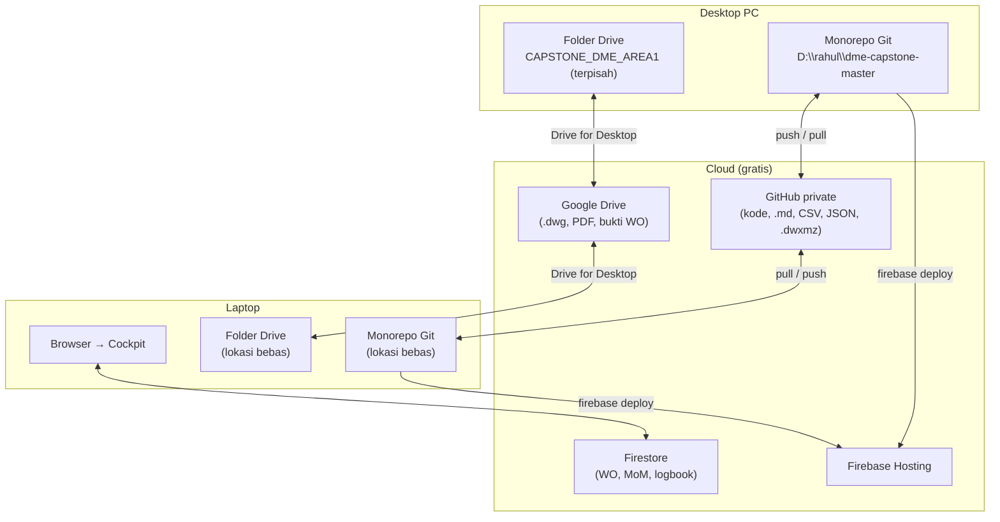

# MASTER BLUEPRINT: EKOSISTEM DATABASE TERPADU & OPERATIONS COCKPIT
**Proyek Capstone:** Front-End Engineering Design (FEED) Pabrik Dimethyl Ether (DME)  
**Program Studi:** Teknik Fisika, Departemen Teknik Nuklir dan Teknik Fisika (DTNTF FT UGM)  
**Tahun Akademik:** 2026/2027  
**Dokumen Kontrol:** DOC-CAPSTONE-DME-2026-MASTER-001  
**Status Anggaran:** Bebas biaya (Rp 0), berbasis FOSS, free tier, dan akun UGM — lihat batasan di BAB VII  
**Versi:** 2.0 (Revisi Konsep pasca Re-Audit Fase 1)  
**Status Dokumen:** Disetujui PM (2026-11-03)  
**Catatan Riwayat Pengerjaan:** [`PROJECT_HISTORY_AND_AUDIT_LOG.md`](PROJECT_HISTORY_AND_AUDIT_LOG.md)

---

## RIWAYAT REVISI DOKUMEN

| Versi | Tanggal | Penyusun | Ringkasan |
| :--- | :--- | :--- | :--- |
| 1.0 | 2026-11-02 | Antigravity (AI agent) + PM | Konsep awal 8 bab, 5 pilar, roadmap 5 fase. |
| 2.0 | 2026-11-03 | Claude Code (AI agent) + PM | Revisi konsep berdasarkan re-audit Fase 1: matriks kepemilikan data (SSOT), siklus status dokumen, aturan companion `.md` yang bisa diaudit, mesin kalkulator berbasis skrip, kebijakan penyimpanan Git vs Drive, pemisahan folder Git dan Drive, WhatsApp gateway dijadikan opsional, Fase 1.5 Remediasi, dan Definition of Done per fase. |

### Ringkasan Perubahan v1.0 → v2.0

| Area | Konsep v1.0 | Masalah yang Ditemukan | Konsep v2.0 |
| :--- | :--- | :--- | :--- |
| SSOT | "Satu sumber kebenaran" tanpa rincian | Sheets dan CSV sama-sama bisa diedit, tidak jelas mana master | **Matriks kepemilikan data**: tiap jenis data punya tepat satu master, salinan lain read-only (§1.2) |
| Status dokumen | Bebas diisi | 11 file berstatus `ACC Final` tanpa review | **Siklus status baku** + bukti wajib untuk `ACC` (§1.4) |
| Companion `.md` | Nama sama persis untuk semua file teknis | Aturan tidak bisa dipenuhi untuk file hasil generate dan multi-format; klaim 100% padahal ~50% | **Companion per artefak** (bukan per format), daftar pengecualian, dan pengecekan otomatis (§5) |
| Pipeline DWSIM | Skrip Python mengekstrak T, P, flow | Skrip (JS) hanya mengambil nama tag; status `Converged` ditulis hardcoded | **Spesifikasi skema output + validasi neraca massa**; status dibaca dari file (§3.1) |
| Kalkulator | File CSV statis | Angka tidak bisa dihitung ulang dan tidak konsisten (q_m dan Re salah) | **Mesin kalkulator Python** (input YAML → hasil CSV), CSV menjadi output yang di-generate (§3.2) |
| Penyimpanan | Git untuk kode, Drive untuk biner | DXF 3–4 MB/file masuk Git (6,9 juta baris); file duplikat | **Kebijakan penyimpanan per jenis file** (§2.2); hasil generate tidak di-commit |
| Sinkronisasi | Folder monorepo disinkronkan Drive | Folder `.git` di dalam Drive berisiko korup | **Folder Git dan folder Drive dipisah**, dihubungkan lewat `DRIVE_ROOT` (§8.2) |
| WhatsApp | Gateway Baileys sebagai pilar utama | Protokol tidak resmi, risiko nomor diblokir | **Tautan `wa.me` sebagai jalur utama**; Baileys opsional dengan nomor cadangan (§3.5) |
| Audit | Klaim "100% PASS" | Klaim tidak disertai bukti dan denominator | **Audit berbasis bukti**: tiap klaim disertai perintah dan output (§9.2) |
| Roadmap | 5 fase | Fase 1 belum tuntas | **Fase 1.5 Remediasi** + Definition of Done terukur per fase (BAB VI) |

---

## DAFTAR ISI
1. [BAB I: Visi Arsitektur & Prinsip Desain](#bab-i-visi-arsitektur--prinsip-desain)
2. [BAB II: Struktur Monorepo, Kebijakan Penyimpanan & Konvensi Penamaan](#bab-ii-struktur-monorepo-kebijakan-penyimpanan--konvensi-penamaan)
3. [BAB III: Arsitektur Integrasi (6 Pilar Sistem)](#bab-iii-arsitektur-integrasi-6-pilar-sistem)
4. [BAB IV: Spesifikasi 12 Modul Website Area-1 Cockpit](#bab-iv-spesifikasi-12-modul-website-area-1-cockpit)
5. [BAB V: Standar Companion Markdown (.md System)](#bab-v-standar-companion-markdown-md-system)
6. [BAB VI: Roadmap Eksekusi & Definition of Done](#bab-vi-roadmap-eksekusi--definition-of-done)
7. [BAB VII: Tata Kelola Tim (RACI) & Jaminan Bebas Biaya](#bab-vii-tata-kelola-tim-raci--jaminan-bebas-biaya)
8. [BAB VIII: Sinkronisasi Multi-Device (Desktop PC ⟷ Laptop)](#bab-viii-sinkronisasi-multi-device-desktop-pc--laptop)
9. [BAB IX: Tata Kelola Pencatatan Riwayat & Audit](#bab-ix-tata-kelola-pencatatan-riwayat--audit)
10. [Lampiran A: Register Risiko](#lampiran-a-register-risiko)

---

## BAB I: Visi Arsitektur & Prinsip Desain

Sistem Master Database Capstone menyatukan artefak rekayasa proses, instrumentasi, kendali, keselamatan, ekonomi, dan manajemen proyek ke dalam satu ekosistem. **Setiap angka teknis harus bisa ditelusuri ke sumbernya dan dihitung ulang oleh siapa pun di tim.**

### 1.1 Diagram Alur Data


### 1.2 Prinsip 1 — Single Source of Truth dengan Matriks Kepemilikan Data

Setiap jenis data memiliki **tepat satu master**. Semua salinan lain bersifat turunan (*derived*), **read-only**, dan wajib bisa dibuat ulang dari master.

| Domain Data | Master (tempat edit) | Turunan (read-only) | Arah Sinkronisasi | PIC (R) |
| :--- | :--- | :--- | :--- | :--- |
| Neraca massa & energi (HMB) | `DME.dwxmz` (DWSIM) | `hmb_streams.json`, tampilan cockpit | DWSIM → JSON (skrip) | IH |
| Pemetaan tag | `tag_map.csv` (Git) | Kolom tag di semua dokumen lain | Satu arah ke dokumen | IH + JN |
| Asumsi desain kalkulator | `inputs/*.yaml` (Git) | — | — | AL / HD |
| Hasil kalkulasi | Dihitung oleh `tools/calc/*.py` | `CALC_*.csv`, datasheet, cockpit | Skrip → CSV | AL / HD |
| Master Instrument Index & IO List | Google Sheets | `Master_Instrument_Index_DME.csv` | Sheets → CSV (satu arah) | JN |
| Narasi FDS & laporan bab 1–4 | Google Docs | Mirror PDF/MD di `06_.../mirrors/` | Docs → mirror | Per bab (RACI) |
| Gambar P&ID & template | `.dwg` di Google Drive | `.dxf` ekspor, `.pdf` plot | DWG → DXF/PDF | JN |
| Library simbol CAD | `generate_libraries.js` | `.dxf` hasil generate (tidak di-commit) | Skrip → DXF | JN |
| Work Order, MoM, logbook | Cloud Firestore | Ekspor/backup JSON | — | RG |
| Kode web & skrip | Git (GitHub private) | — | — | RG |

**Aturan turunan:** file turunan **tidak boleh diedit manual**. Kalau ada yang salah, perbaiki di master, lalu jalankan ulang skripnya. File turunan mencantumkan baris header `GENERATED — jangan edit manual; sumber: <master>; dibuat: <timestamp>` jika formatnya mengizinkan.

### 1.3 Prinsip 2 — Ketertelusuran Data (*Data Provenance*)

1. Setiap nilai input pada kalkulator atau datasheet mencantumkan **sumber yang spesifik**: tag stream DWSIM + timestamp ekstraksi HMB, nomor standar + klausul, atau `ASUMSI` beserta alasannya.
2. Nilai yang belum punya sumber **wajib ditandai `PLACEHOLDER`**. Placeholder tidak boleh berstatus di atas `Draft`.
3. Skrip **dilarang menulis nilai hardcoded yang terlihat seperti hasil** (contoh: `"status": "Converged"` tanpa membaca file). Jika data tidak ditemukan, skrip **gagal dengan pesan jelas**, bukan diam-diam menulis nilai default.
4. Angka hasil harus **bisa dihitung ulang**. Satu perintah (`npm run calc` / `python -m tools.calc`) menghasilkan ulang seluruh CSV hasil dari HMB + input YAML.

### 1.4 Prinsip 3 — Siklus Status Dokumen Baku

```text
Draft ──► WIP ──► Review Internal ──► Diajukan ──► ACC Pembimbing
  ▲                     │                 │
  └──── Revisi ◄────────┴─────────────────┘
```

| Status | Arti | Siapa yang boleh menetapkan | Bukti wajib |
| :--- | :--- | :--- | :--- |
| `Draft` | Kerangka atau isi masih placeholder | Siapa saja | — |
| `WIP` | Sedang dikerjakan, sebagian data riil | PIC (R) | — |
| `Review Internal` | Selesai menurut PIC, menunggu cek silang | PIC (R) | Nama reviewer internal |
| `Diajukan` | Dikirim ke dosen pembimbing | PM (A) | Tanggal pengajuan + kode WO |
| `ACC Pembimbing` | Disetujui dosen pembimbing | PM (A) **setelah** ada persetujuan dosen | Referensi MoM atau dokumen persetujuan |
| `Revisi` | Dikembalikan dengan catatan | PM (A) | Referensi MoM |

**AI agent (Antigravity, Claude Code, dll.) tidak boleh menetapkan status di atas `Review Internal`.**

### 1.5 Prinsip 4 — Companion Markdown per Artefak

Setiap **artefak teknis** (bukan setiap format file) didampingi satu file `.md` yang menjelaskan tujuan, sumber data, rumus, SOP, dan batasannya. Aturan lengkap ada di BAB V.

### 1.6 Prinsip 5 — Audit Berbasis Bukti

Setiap klaim "selesai" atau "PASS" harus disertai **perintah yang dijalankan, output aktual, dan denominator yang jujur** (contoh: "12 dari 22 artefak", bukan "100%"). Aturan lengkap ada di BAB IX.

### 1.7 Prinsip 6 — Kesiapan Audit Akademik (DTNTF FT UGM)

Seluruh artefak terikat pada rubrik Capstone DTNTF 2026 dan dapat dikompilasi ke bundel sidang Stage-Gate 1–4. Hanya artefak berstatus `Diajukan` atau `ACC Pembimbing` yang masuk bundel.

---

## BAB II: Struktur Monorepo, Kebijakan Penyimpanan & Konvensi Penamaan

### 2.1 Struktur Direktori

Root kerja: **`D:\rahul\dme-capstone-master`** (di laptop boleh di lokasi lain; semua skrip memakai path relatif).

Legenda: `[ADA]` sudah ada · `[BARU]` belum dibuat · `[GEN]` hasil generate, tidak di-commit · `[DRIVE]` disimpan di Google Drive, bukan Git

```text
dme-capstone-master/
├── 00_CORE_GUIDELINES/
│   ├── Panduan_Capstone_DTNTF_2026.pdf          [ADA] [DRIVE*] rujukan eksternal
│   ├── Panduan_Capstone_DTNTF_2026.md           [BARU] ringkasan tahapan, rubrik, matriks nilai
│   └── standards/                               [BARU] ringkasan ISA 5.1, ISO 10628, API 520, ASME PTC 19.3, IEC 60534
│
├── 01_PROCESS_SIMULATION_DWSIM/
│   ├── simulation_files/
│   │   ├── DME.dwxmz                            [ADA] master HMB (±110 KB, tetap di Git untuk versioning)
│   │   └── DME.md                               [ADA]
│   ├── exported_data/
│   │   ├── hmb_streams.json                     [ADA→REVISI] skema baru §3.1
│   │   └── hmb_streams.md                       [BARU] kamus skema & satuan
│   ├── tag_map.csv                              [BARU] tag DWSIM ↔ tag pabrik
│   └── tag_map.md                               [BARU]
│
├── 02_ENGINEERING_CALCULATORS/
│   ├── inputs/                                  [BARU] master asumsi desain (YAML)
│   │   ├── orifice_FE-101.yaml
│   │   └── ...
│   ├── CALC_ISO5167_Orifice.csv / .md           [ADA→GEN] CSV menjadi hasil generate
│   ├── CALC_ISA75_ControlValve.csv / .md        [ADA→GEN]
│   ├── CALC_API520_PSV.csv / .md                [ADA→GEN]
│   ├── CALC_ASME_Thermowell.csv / .md           [ADA→GEN]
│   └── CALC_TeknoEkonomi_NPV.csv / .md          [ADA→GEN]
│
├── 03_CAD_AND_PID_LIBRARIES/
│   ├── templates/
│   │   ├── DME_Master_Template.dwt              [ADA] [DRIVE] satu-satunya template (duplikat dihapus)
│   │   ├── DME_Master_Template.md               [ADA]
│   │   ├── acad_dme.lin                         [ADA]
│   │   └── acad_dme.md                          [ADA→RENAME] dari acad_dme_lin.md
│   ├── symbol_libraries/
│   │   ├── *.dxf                                [GEN] dibuat ulang oleh generate_libraries.js
│   │   └── SYMBOL_LIBRARIES.md                  [BARU] satu companion untuk seluruh library
│   └── scripts/
│       └── generate_libraries.js                [ADA]
│
├── 04_INSTRUMENTATION_ISA20/
│   ├── Master_Instrument_Index_DME.csv / .md    [ADA] snapshot dari Google Sheets
│   └── datasheets/                              [BARU] DS_ISA20_*.csv / .md
│
├── 05_SAFETY_AND_CONTROL/
│   ├── Cause_and_Effect_Matrix_ESD.csv / .md    [ADA]
│   ├── FDS_Control_Narrative_ISA506.md          [ADA] (master pindah ke Google Docs di Fase 2)
│   └── Master_Alarm_Database_ISA182.csv / .md   [ADA]
│
├── 06_COLLABORATIVE_WORKSPACE/
│   ├── google_workspace_registry.json           [BARU] ID & URL Docs/Sheets/Drive
│   ├── Google_Workspace_Guide.md                [BARU]
│   └── mirrors/                                 [BARU] mirror teks Docs/Sheets
│
├── 07_FINAL_DELIVERABLES/                       [DRIVE] DWG & PDF final; di Git hanya .md indeksnya
│   ├── drawings/DELIVERABLES_DRAWINGS.md        [BARU]
│   └── reports/DELIVERABLES_REPORTS.md          [BARU]
│
├── apps/operations-cockpit/                     [ADA] React + Vite + Firebase (9 dari 12 modul)
│
├── tools/
│   ├── dwsim/export_hmb.py                      [BARU] menggantikan tools/export_dwsim_hmb.js
│   ├── calc/                                    [BARU] mesin kalkulator Python
│   ├── sync/pull_sheets.py                      [BARU] Sheets → CSV
│   ├── validate_tags.py                         [BARU]
│   ├── check_companions.py                      [BARU] pengecek aturan companion & status
│   ├── build_manifest.js                        [BARU] indeks .md untuk modul Master Library
│   ├── requirements.txt                         [BARU] fluids, ezdxf, pyyaml, numpy-financial
│   └── whatsapp-bot/                            [OPSIONAL] lihat §3.5
│
├── .env.example                                 [BARU] DRIVE_ROOT, dll.
├── README.md                                    [ADA→REVISI] orientasi singkat (bukan salinan blueprint)
├── MASTER_CAPSTONE_ECOSYSTEM_BLUEPRINT.md       [ADA] dokumen ini
└── PROJECT_HISTORY_AND_AUDIT_LOG.md             [ADA] riwayat pengerjaan & audit
```

**Keputusan struktur v2.0:**
- **Semua skrip otomasi berada di `tools/`.** Folder `01_.../scripts/` yang kosong dihapus agar tidak ada dua lokasi skrip.
- **Bahasa pipeline data rekayasa: Python.** Alasannya: tersedia library teknik gratis yang sudah tervalidasi (`fluids` untuk ISO 5167, IEC 60534/ISA-75, API 520; `ezdxf` untuk membaca DXF), dan lebih familiar bagi tim teknik. Node.js tetap dipakai untuk web cockpit, `generate_libraries.js`, dan gateway WhatsApp.

### 2.2 Kebijakan Penyimpanan (Git vs Google Drive)

| Jenis File | Lokasi | Alasan |
| :--- | :--- | :--- |
| Kode (`.ts`, `.tsx`, `.js`, `.py`), konfigurasi, `.md` | **Git** | Teks kecil, perlu riwayat & review |
| Data teks kecil (`.csv`, `.json`, `.yaml`, `.lin`) | **Git** | Bisa di-diff, ukuran kecil |
| `DME.dwxmz` (±110 KB) | **Git** | Master HMB; versinya harus terikat dengan hasil ekstraksi |
| Hasil generate (`symbol_libraries/*.dxf`, `dist/`) | **Tidak disimpan** (`.gitignore`) | Dibuat ulang dari skrip |
| `.dwg`, `.dwt`, `.dxf` hasil gambar manual | **Drive** | Biner besar, tidak bisa di-diff |
| PDF plot, PDF panduan, FEED book | **Drive** | Biner besar |
| Bukti Work Order (foto, scan, lampiran) | **Drive** (`08_WORK_ORDERS_EVIDENCE/`) | Biner, sering bertambah |
| File sementara AutoCAD (`*_recover.dwg`, `*.bak`, `*.dwl`, `*.dwl2`, `plot.log`) | **Diabaikan** (`.gitignore`) | Sampah kerja |

Batas praktis: **tidak ada file > 5 MB di Git.** Git LFS tidak dipakai karena kuota gratis GitHub terbatas.

### 2.3 Konvensi Penamaan & Tag

1. **Tag pabrik (plant tag)** adalah satu-satunya tag yang dipakai di P&ID, datasheet, FDS, C&E, alarm database, dan laporan. Format mengikuti ISA-5.1 dengan nomor area:
   - Peralatan: `<kode>-<area><nomor>` → contoh `P-101`, `R-101`, `E-101`, `T-201`.
   - Instrumen: `<fungsi ISA>-<area><nomor loop>` → contoh `FT-101`, `TIC-102`, `PSV-103`.
   - Stream: `S-<area><nomor>` → contoh `S-101`.
2. **Tag DWSIM** (`S-01`, `RC-01`, `CSCOL-01`, …) hanya dipakai di dalam simulasi. Pemetaannya ke tag pabrik **wajib** tercatat di `tag_map.csv`:

   ```csv
   dwsim_tag,plant_tag,object_type,description,area
   S-01,S-101,MaterialStream,Umpan metanol cair,100
   PUMP-01,P-101,Pump,Pompa umpan metanol,100
   RC-01,R-101,ConversionReactor,Reaktor dehidrasi metanol,100
   CSCOL-01,T-201,DistillationColumn,Kolom pemurnian DME,200
   ```
   *(Nilai di atas contoh format; isi final ditetapkan oleh IH dan JN.)*
3. Variasi tag liar seperti `REAC-01`, `R-01`, dan `RC-01` untuk objek yang sama **tidak diperbolehkan**. `validate_tags.py` akan menandainya.

---

## BAB III: Arsitektur Integrasi (6 Pilar Sistem)

### 3.1 Pilar 1 — Simulator Proses DWSIM

* **File master:** `01_PROCESS_SIMULATION_DWSIM/simulation_files/DME.dwxmz`.
* **Model:** dehidrasi metanol fase gas $2\,\text{CH}_3\text{OH} \rightarrow \text{CH}_3\text{OCH}_3 + \text{H}_2\text{O}$ ($\Delta H_r \approx -23{,}4\ \text{kJ/mol}$, eksotermik), property package NRTL. Nilai $\Delta H_r$ dan kondisi operasi harus dikonfirmasi IH terhadap literatur dan dicantumkan rujukannya di `DME.md`.
* **Skrip ekstraksi:** `tools/dwsim/export_hmb.py`.
  1. Membuka arsip `.dwxmz` (ZIP) dan **mencari file XML di dalamnya secara dinamis** (nama XML tidak boleh di-hardcode).
  2. Membaca setiap material stream: suhu, tekanan, laju alir massa & molar, fraksi uap, komposisi mol, densitas, viskositas, Cp, dan MW per fase.
  3. Membaca status solver, property package, dan daftar komponen **dari file**, bukan ditulis tetap.
  4. Mengonversi satuan internal DWSIM (SI: K, Pa, kg/s) ke satuan rekayasa, dan mencatat satuan di JSON.
  5. **Validasi:** neraca massa per unit operasi harus tertutup (selisih ≤ 0,5%). Objek tanpa tag, stream tanpa nilai, atau tag duplikat menyebabkan skrip **gagal** dengan daftar masalah.
  6. Menulis `hmb_streams.json` dengan skema berikut:

```json
{
  "meta": {
    "source_file": "DME.dwxmz",
    "source_sha256": "<hash file simulasi>",
    "extracted_at": "2026-11-05T10:00:00+07:00",
    "extractor_version": "1.0.0",
    "solver_status": "<dibaca dari file>",
    "property_package": "<dibaca dari file>",
    "compounds": ["Methanol", "Water", "Dimethyl ether"],
    "units": { "T": "degC", "P": "bar(a)", "mass_flow": "kg/h", "rho": "kg/m3", "mu": "cP" }
  },
  "streams": [
    {
      "dwsim_tag": "S-01",
      "plant_tag": "S-101",
      "T": 0.0, "P": 0.0, "mass_flow": 0.0, "molar_flow": 0.0,
      "vapor_fraction": 0.0,
      "mole_fractions": { "Methanol": 0.0, "Water": 0.0, "Dimethyl ether": 0.0 },
      "props": { "rho": 0.0, "mu": 0.0, "cp": 0.0, "mw": 0.0 }
    }
  ],
  "unit_operations": [
    { "dwsim_tag": "RC-01", "plant_tag": "R-101", "type": "Conversion Reactor", "duty_kW": 0.0, "inlets": ["S-04"], "outlets": ["S-05"] }
  ],
  "validation": { "mass_balance_max_error_pct": 0.0, "warnings": [] }
}
```
*(Angka `0.0` hanya penanda skema.)*

* **Konsumen data:** mesin kalkulator (§3.2) dan modul `DwsimStreamView` di cockpit (dibundel saat build, §3.6).
* **SOP:** setelah DWSIM dijalankan dan konvergen → simpan `.dwxmz` → jalankan `npm run sync:dwsim` → jalankan `npm run calc` → commit `.dwxmz`, `hmb_streams.json`, dan seluruh CSV hasil **dalam satu commit** supaya versi simulasi dan hasil kalkulasi selalu cocok.

### 3.2 Pilar 2 — Mesin Kalkulator Rekayasa

File CSV statis tidak bisa dihitung ulang, sehingga kesalahannya tidak terdeteksi. Pada v2.0, kalkulator menjadi **skrip** dan CSV menjadi **laporan hasil**.

| Kalkulator | Standar | Implementasi (Python, gratis) | Input dari HMB |
| :--- | :--- | :--- | :--- |
| Orifice plate | ISO 5167-1/2 | `fluids.flow_meter` (Reader-Harris/Gallagher, faktor ekspansi) | q_m, P, T, ρ, μ, κ |
| Control valve | ISA-75.01 / IEC 60534-2-1 | `fluids.control_valve` (`size_control_valve_l/_g`) | q, P1, P2, ρ, μ, Pv |
| PSV | API 520 Part I | `fluids.safety_valve` (`API520_A_g`, `API520_A_L`) | W, P_set, T, MW, Z, k |
| Thermowell | ASME PTC 19.3 TW-2016 | Implementasi manual + uji kasus contoh dari standar | v, ρ, μ |
| Tekno-ekonomi | — | Python (`numpy-financial`) | Kapasitas & utilitas dari HMB |

**Alur kerja:**
1. Asumsi desain yang **bukan** dari HMB (diameter pipa, ΔP desain, material, harga, umur pabrik) ditulis di `02_ENGINEERING_CALCULATORS/inputs/<tag>.yaml`, lengkap dengan sumbernya.
2. Rujukan ke HMB ditulis sebagai tag stream (contoh `stream: S-101`). Skrip mengambil nilainya dari `hmb_streams.json`.
3. `npm run calc` menghasilkan ulang semua `CALC_*.csv` dan menulis timestamp HMB yang dipakai.
4. **Pemeriksaan otomatis:** batas standar (contoh β 0,10–0,75 dan Re_D minimum pada ISO 5167) diperiksa skrip. Pelanggaran dilaporkan sebagai `FAIL`.
5. Setiap kalkulator memiliki **minimal satu uji verifikasi** terhadap contoh soal dari standar atau buku acuan. Ini menjadi bukti kebenaran saat sidang.

### 3.3 Pilar 3 — Google Workspace (Drive, Docs, Sheets, Calendar)

* **Akun:** akun mahasiswa UGM (`@mail.ugm.ac.id`).
* **Folder Drive `CAPSTONE_DME_AREA1/` adalah folder terpisah dari monorepo Git** (lihat §8.2). Isinya biner dan dokumen kolaborasi:
  - `00_CORE_GUIDELINES/` — PDF panduan & standar
  - `03_CAD_DWG/` — `.dwg`/`.dwt` master gambar & template
  - `04_INSTRUMENT_INDEX_SHEETS/` — Google Sheets master
  - `06_LIVING_REPORTS_GDOCS/` — Google Docs laporan & FDS
  - `07_FINAL_DELIVERABLES_PDF/` — PDF plot & FEED book
  - `08_WORK_ORDERS_EVIDENCE/WO-XXX/` — bukti Work Order
  - `09_STAGE_GATES_SUBMISSIONS/` — bundel sidang
* **Google Sheets → CSV (satu arah):** `tools/sync/pull_sheets.py` mengunduh sheet sebagai CSV ke `04_INSTRUMENTATION_ISA20/`. Metode, berurutan dari yang dicoba lebih dulu:
  1. Service account Google Cloud (gratis), jika akun UGM mengizinkan pembuatan project GCP.
  2. Fallback manual: *File → Download → CSV*, lalu jalankan `pull_sheets.py --from-file <csv>` untuk validasi kolom.
  CSV di repo **tidak pernah diedit langsung**; perubahan selalu lewat Sheets.
* **Google Docs:** master narasi laporan dan FDS. Cockpit menyimpan tautannya di `google_workspace_registry.json`.
* **Google Calendar & Meet:** jadwal bimbingan dosen.

### 3.4 Pilar 4 — AutoCAD Drafting & Validasi Tag

* **Library simbol:** dibuat oleh `generate_libraries.js` → `.dxf` tidak di-commit. Perintah: `npm run gen:cad`.
* **Gambar P&ID:** master `.dwg` di Drive. Untuk validasi dan web, gambar diekspor:
  - ke **DXF** (perintah `SAVEAS` di AutoCAD, atau ODA File Converter yang gratis) untuk dibaca skrip;
  - ke **PDF** (A1/A3) untuk dibaca dosen dan cockpit.
* **`tools/validate_tags.py`** (memakai `ezdxf`):
  1. Membaca atribut blok instrumen dan peralatan dari DXF P&ID.
  2. Membandingkannya dengan `Master_Instrument_Index_DME.csv`, `tag_map.csv`, dan tag yang disebut di FDS / C&E / alarm database.
  3. Mengeluarkan laporan: tag di gambar tapi tidak di index (*phantom tag*), tag di index tapi tidak di gambar, dan tag yang melanggar format §2.3.
  4. Laporan ditulis ke `exported_data/tag_validation_report.json` dan ditampilkan di cockpit.

### 3.5 Pilar 5 — Notifikasi WhatsApp Grup

* **Jalur utama: tautan `wa.me` / `https://wa.me/?text=...`** dari cockpit. Pesan sudah terformat, PIC cukup menekan Kirim. Tanpa server, tanpa risiko, Rp 0.
* **Jalur opsional: gateway lokal Baileys** (`tools/whatsapp-bot/`) untuk kirim otomatis.
  - **Risiko:** Baileys memakai protokol WhatsApp Web yang **tidak resmi**. Penggunaan otomatis dapat melanggar ketentuan WhatsApp dan berisiko **nomor diblokir**.
  - **Mitigasi wajib:** gunakan **nomor cadangan**, bukan nomor pribadi PM; batasi frekuensi kirim; folder sesi `auth_info/` tidak pernah di-commit.
  - Dikerjakan hanya jika seluruh Fase 1.5–4 sudah selesai (masuk Fase 5, opsional).
* **Pemicu notifikasi:** WO baru/kritis, deadline H-2, ringkasan action item MoM.

### 3.6 Pilar 6 — Cloud & Database (Firebase Spark Plan)

* **Paket:** Firebase Spark (gratis, tanpa kartu kredit). Kuota: Firestore 50.000 baca & 20.000 tulis per hari; Hosting 10 GB penyimpanan & 360 MB transfer per hari.
* **Hosting tunggal: Firebase Hosting** (project `area1-dme-cockpit`). `vercel.json` dihapus di Fase 1.5 agar tidak ada dua jalur deploy.
* **Model data Firestore (kondisi saat ini):**
  - koleksi `users`
  - koleksi `workOrders` (satu dokumen per WO)
  - dokumen tunggal `projectData/area1` (data bersama lainnya)
* **Risiko batas dokumen 1 MiB:** `projectData/area1` akan terus membesar karena MoM, logbook, dan jadwal. **Aturan:** jika ukuran dokumen > 500 KB, data yang tumbuh (MoM, logbook) dipindah ke koleksi tersendiri (`moms`, `logbook`), mengikuti pola `workOrders`.
* **Data rekayasa statis** (HMB, hasil kalkulasi, laporan validasi tag, manifest `.md`) **tidak disimpan di Firestore**. Data itu dibundel ke aplikasi saat build (`apps/operations-cockpit/public/data/`). Konsekuensinya, data di web hanya sesegar deploy terakhir, dan tanggal ekstraksinya ditampilkan di UI.

---

## BAB IV: Spesifikasi 12 Modul Website Area-1 Cockpit

```text
┌────────────────────────────────────────────────────────────────────────┐
│                   AREA-1 DME OPERATIONS COCKPIT                        │
├─────────────────┬─────────────────────┬────────────────────────────────┤
│ GOVERNANCE      │ ENGINEERING HUB     │ DTNTF ACADEMIC                 │
├─────────────────┼─────────────────────┼────────────────────────────────┤
│ 1. Homepage     │ 6. DWSIM Stream Hub │ 11. Logbook Presensi UGM       │
│ 2. Work Orders  │ 7. Workspaces       │ 12. Stage-Gate & Sidang Rubrik │
│ 3. Schedule     │ 8. Standards        │                                │
│ 4. Team RACI    │ 9. Master Library   │                                │
│ 5. Weekly MoM   │ 10. Google Workspace│                                │
└─────────────────┴─────────────────────┴────────────────────────────────┘
```

| No | Modul (komponen) | Status | Sumber Data | Fungsi |
| :---: | :--- | :---: | :--- | :--- |
| 1 | Homepage (`HomepageView.tsx`) | Ada | Firestore | Dashboard eksekutif: progres deliverable, banner, jadwal bimbingan terdekat. Progres dihitung dari status baku §1.4. |
| 2 | Work Orders (`WorkOrdersView.tsx`) | Ada | Firestore `workOrders` | Tiket kerja berbasis bukti, board/list, status `Ditugaskan → Dikerjakan → Blocked → Diajukan → Selesai`, tautan folder Drive, tombol `wa.me`. |
| 3 | Schedule & Gantt (`ScheduleView.tsx`) | Ada | Firestore | Timeline 16 minggu, jalur kritis, terhubung dengan penutupan WO. |
| 4 | Team RACI (`TeamRaciView.tsx`) | Ada | Firestore | Matriks RACI per bab dan gambar, profil tim. |
| 5 | Weekly MoM (`WeeklyMoMView.tsx`) | Ada | Firestore | Notulensi bimbingan, action item menjadi WO, **referensi MoM menjadi bukti status `ACC Pembimbing`**. |
| 6 | DWSIM Stream Hub (`DwsimStreamView.tsx`) | **Baru** | `public/data/hmb_streams.json` | Tabel HMB (T, P, flow, fraksi uap, komposisi) dengan tag pabrik + tanggal ekstraksi. |
| 7 | Workspaces & Deliverables (`WorkspacesView.tsx`) | Ada | Firestore + Drive | Pelacak 10 deliverable FEED, preview PDF dari Drive. |
| 8 | Standards (`StandardsView.tsx`) | Ada | Statis + Drive | Rujukan standar ISA/ISO/API/ASME/IEC. |
| 9 | Master Library (`MasterLibraryView.tsx`) | **Baru** | `public/data/library_manifest.json` (dari `build_manifest.js`) | Penjelajah artefak + pembaca `.md` (KaTeX) + indikator status & kepatuhan companion. |
| 10 | Google Workspace Hub (`GoogleWorkspaceView.tsx`) | **Baru** | `google_workspace_registry.json` | Tautan ke Docs, Sheets, Drive. |
| 11 | Logbook Presensi (`LogbookView.tsx`) | Ada | Firestore | Logbook harian/mingguan + ekspor rekap untuk Simaster. |
| 12 | Stage-Gate (`StageGateView.tsx`) | Ada | Firestore + manifest | Evaluasi kesiapan Gate 1–4 terhadap rubrik DTNTF; hanya artefak berstatus `Diajukan`/`ACC Pembimbing` yang dihitung. |

**Tambahan v2.0:** panel **"Kesehatan Data"** di Homepage menampilkan umur `hmb_streams.json`, jumlah `FAIL` kalkulator, jumlah inkonsistensi tag, dan jumlah artefak tanpa companion.

---

## BAB V: Standar Companion Markdown (.md System)

### 5.1 Aturan Penamaan & Cakupan

1. **Satu companion per artefak, bukan per format.** Artefak yang punya beberapa format (contoh `DME_Master_Template.dwt/.dwg/.dxf/.pdf`) cukup punya **satu** `DME_Master_Template.md`. Semua formatnya didaftarkan di `target_files`.
2. **Nama companion = nama dasar artefak + `.md`.** Ekstensi tidak ikut nama (`acad_dme.lin` → `acad_dme.md`).
3. **Wajib companion:** simulasi (`.dwxmz`), input & hasil kalkulator, index & datasheet instrumen, C&E, alarm database, template & gambar CAD, data ekspor (`hmb_streams.json`), dan dokumen rujukan PDF.
4. **Satu companion kolektif boleh dipakai** untuk sekumpulan file sejenis yang dibuat oleh satu skrip (contoh: seluruh `symbol_libraries/*.dxf` → `SYMBOL_LIBRARIES.md`).
5. **Tidak wajib companion:** kode sumber (dokumentasi lewat komentar & README), file konfigurasi, file sementara.
6. **Pengecekan otomatis:** `tools/check_companions.py` melaporkan artefak tanpa companion, `target_files` yang tidak ada, status di luar daftar §1.4, dan status `ACC Pembimbing` tanpa `review_evidence`. Laporan ini menjadi angka resmi kepatuhan (bukan hitungan manual).

### 5.2 Format Header YAML

```markdown
---
id: "CALC-ISO5167-FE101"
title: "Sizing Orifice Plate FE-101 (Umpan Metanol ke R-101)"
category: "Engineering Calculator"
standard: "ISO 5167-1:2022 / ISO 5167-2:2022"
target_files:
  - "CALC_ISO5167_Orifice.csv"
  - "inputs/orifice_FE-101.yaml"
generated_by: "tools/calc/orifice.py"
source_data:
  - "hmb_streams.json → S-101 (extracted_at: 2026-11-05T10:00+07:00)"
author: "Altaf Ramadhan Parvez"
reviewer: "Jonathan Pangihutan Michael Siahaan"
status: "Draft"            # Draft | WIP | Review Internal | Diajukan | ACC Pembimbing | Revisi
review_evidence: ""        # wajib jika status Diajukan/ACC Pembimbing: kode WO atau referensi MoM
google_ref: ""
last_updated: "2026-11-05"
tags: ["Flow", "Orifice", "Area-100", "Instrumentation"]
---
```
*(Seluruh nilai di atas adalah contoh format.)*

### 5.3 Isi Wajib Companion

1. **Tujuan & ruang lingkup** — apa yang dihitung atau digambar, untuk tag mana.
2. **Standar acuan** — nomor standar + klausul yang dipakai.
3. **Tabel parameter input** — variabel, simbol, satuan, **sumber spesifik** (tag stream / asumsi / standar), status (`OK` / `PLACEHOLDER`).
4. **Persamaan** — rumus utama (LaTeX/KaTeX) dan batas keberlakuannya.
5. **Hasil & pemeriksaan batas** — ringkasan hasil dan status `PASS/FAIL` terhadap batas standar.
6. **Verifikasi** — contoh kasus uji yang dipakai untuk membuktikan perhitungan benar.
7. **SOP** — langkah memperbarui hasil (perintah skrip yang dijalankan).
8. **Log revisi** — Rev, tanggal, penulis, deskripsi.

---

## BAB VI: Roadmap Eksekusi & Definition of Done

```text
┌───────────────┬────────────────────────────────────────────────────────┬──────────────┐
│ FASE 1        │ Konsolidasi Monorepo & Companion .md                   │ PARSIAL      │
│ FASE 1.5      │ Remediasi Fondasi (BARU)                               │ BERIKUTNYA   │
│ FASE 2        │ Cloud Backbone: GitHub, Google Drive & Workspace       │ Rencana      │
│ FASE 3        │ Pipeline Data: DWSIM → Kalkulator → Validasi Tag       │ Rencana      │
│ FASE 4        │ Upgrade Cockpit: 3 Modul Baru + Panel Kesehatan Data   │ Rencana      │
│ FASE 5        │ Validasi Lintas Sistem, Otomasi Akademik & Rilis       │ Rencana      │
└───────────────┴────────────────────────────────────────────────────────┴──────────────┘
```

Setiap fase dinyatakan selesai **hanya jika semua butir Definition of Done (DoD) terpenuhi dan dibuktikan** di log riwayat (BAB IX).

#### FASE 1: Konsolidasi Monorepo & Companion `.md` — Status: PARSIAL
* **Sudah tercapai:** struktur folder, pemindahan aset CAD/simulasi/kalkulator, integrasi source cockpit ke monorepo, `tsc --noEmit` 0 error.
* **Belum tercapai:** ekstraksi HMB berisi data proses, kepatuhan companion penuh, repo bersih dari file besar. Semua sisa pekerjaan dipindah ke Fase 1.5.

#### FASE 1.5: Remediasi Fondasi (BARU) — Estimasi 1–2 hari
* **Aktivitas:**
  1. Ubah semua `status: "ACC Final"` menjadi `Draft` atau `WIP` sesuai kondisi riil.
  2. Tandai nilai kalkulator yang belum punya sumber sebagai `PLACEHOLDER`.
  3. Hapus file duplikat (`Engineering_Drawing_Template.*`, `DME_Master_Template.dwg/.dxf` jika identik dengan `.dwt`); pindahkan biner CAD ke Drive.
  4. Keluarkan `symbol_libraries/*.dxf` dari Git (`.gitignore` + `npm run gen:cad`).
  5. Tambahkan pola file sementara AutoCAD ke `.gitignore` (`*_recover.dwg`, `*.bak`, `*.dwl`, `*.dwl2`).
  6. **Bersihkan riwayat Git dari file besar sebelum push pertama ke GitHub** (saat ini belum ada remote, jadi ini momen termurah). Tindakan ini menulis ulang riwayat dan **wajib persetujuan PM**.
  7. Ganti nama `acad_dme_lin.md` → `acad_dme.md`; buat `SYMBOL_LIBRARIES.md`, `hmb_streams.md`, `Panduan_Capstone_DTNTF_2026.md`.
  8. Ganti `README.md` dengan orientasi singkat (bukan salinan blueprint).
  9. Hapus `vercel.json`; perbaiki skrip `sync:push` sesuai §8.3.
  10. Buat `tools/check_companions.py` versi awal.
* **DoD:**
  - [ ] `check_companions.py` melaporkan 0 artefak wajib tanpa companion dan 0 status tidak valid.
  - [ ] Tidak ada file > 5 MB di riwayat Git (`git rev-list --objects --all` + cek ukuran).
  - [ ] `git status` bersih setelah sesi kerja AutoCAD (file sementara ter-ignore).
  - [ ] Tidak ada file duplikat (hash identik) di repo.
  - [ ] Entri log riwayat Fase 1.5 lengkap dengan bukti.

#### FASE 2: Cloud Backbone — Estimasi 2 hari
* **Aktivitas:** buat repo GitHub private + push; buat folder Drive `CAPSTONE_DME_AREA1/` terpisah dari monorepo; isi `.env.local` dengan `DRIVE_ROOT`; buat Google Sheets Master Instrument Index & IO List; buat Google Docs FDS & laporan; isi `google_workspace_registry.json`; buat `pull_sheets.py`.
* **DoD:**
  - [ ] `git clone` di laptop + `npm install` + `npm run build` berhasil tanpa langkah manual tambahan.
  - [ ] `pull_sheets.py` menghasilkan CSV yang sama kolomnya dengan Sheets.
  - [ ] Semua URL di registry bisa dibuka oleh seluruh anggota tim.

#### FASE 3: Pipeline Data DWSIM → Kalkulator → Validasi Tag — Estimasi 4–5 hari
* **Aktivitas:** `tools/dwsim/export_hmb.py` (skema §3.1); `tag_map.csv`; mesin kalkulator `tools/calc/` + input YAML; uji verifikasi per kalkulator; `validate_tags.py`.
* **DoD:**
  - [ ] `hmb_streams.json` memuat T, P, flow, komposisi, dan properti untuk seluruh stream; status solver dibaca dari file.
  - [ ] Neraca massa tertutup ≤ 0,5% untuk semua unit operasi.
  - [ ] `npm run calc` menghasilkan ulang semua `CALC_*.csv` dari nol; setiap kalkulator lulus minimal satu uji verifikasi.
  - [ ] `validate_tags.py` berjalan pada minimal satu P&ID DXF dan menghasilkan laporan.
  - [ ] Tidak ada nilai di CSV hasil yang tidak bisa ditelusuri ke HMB, YAML, atau standar.

#### FASE 4: Upgrade Cockpit — Estimasi 3–4 hari
* **Aktivitas:** `DwsimStreamView`, `MasterLibraryView` (+ `build_manifest.js`), `GoogleWorkspaceView`, panel Kesehatan Data, tombol `wa.me` di WO & MoM, rute baru di `Header.tsx`/`App.tsx`, `npm run build` menyalin data rekayasa ke `public/data/`.
* **DoD:**
  - [ ] `tsc --noEmit` 0 error dan `npm run build` sukses (waktu build dicatat).
  - [ ] 12 modul dapat dibuka tanpa error di console browser.
  - [ ] Data HMB di web sama dengan `hmb_streams.json` terbaru (dicek tanggal ekstraksinya).

#### FASE 5: Validasi Lintas Sistem, Otomasi Akademik & Rilis — Estimasi 3 hari
* **Aktivitas:** validasi tag menyeluruh; ekspor Logbook ke format Simaster; kompilasi bundel Stage-Gate di Drive; deploy ke Firebase Hosting; serah terima ke tim; **(opsional)** gateway WhatsApp Baileys dengan nomor cadangan.
* **DoD:**
  - [ ] Laporan validasi tag: 0 phantom tag pada P&ID yang berstatus `Diajukan`.
  - [ ] Seluruh anggota tim berhasil login dan membuat WO percobaan di versi produksi.
  - [ ] Ukuran dokumen `projectData/area1` tercatat dan < 500 KB.
  - [ ] Re-audit akhir tercatat di log riwayat.

---

## BAB VII: Tata Kelola Tim (RACI) & Jaminan Bebas Biaya

### 7.1 Pembagian Peran Anggota Tim

| Anggota Tim | Posisi & Inisial | Email Resmi UGM | Tanggung Jawab Utama dalam Sistem |
| :--- | :--- | :--- | :--- |
| **Rahul Ghulam Hidayatulloh** | Project Manager (RG) | `rahulghulamhidayatulloh2004@mail.ugm.ac.id` | **Accountable (A)**: otorisasi monorepo, review WO, penetapan status `Diajukan`/`ACC Pembimbing`, persetujuan perubahan blueprint, otorisasi rilis Stage-Gate. |
| **Ihsaan Zauhair Tsaqif Prawira** | Lead Process Engineer (IH) | `ihsaanzauhairtsaqifprawira@mail.ugm.ac.id` | **Responsible (R)**: DWSIM (`DME.dwxmz`), validasi neraca massa & energi, `tag_map.csv`, PFD ISO 10628. |
| **Altaf Ramadhan Parvez** | Lead Instrument Engineer 1 (AL) | `altaframadhanparvez@mail.ugm.ac.id` | **Responsible (R)**: kalkulator Orifice & Control Valve (input YAML + uji verifikasi), FDS ISA-5.06, matriks C&E ESD. |
| **Jonathan Pangihutan Michael Siahaan** | Lead Instrument Engineer 2 (JN) | `jonathanpangihutanms@mail.ugm.ac.id` | **Responsible (R)**: template & library AutoCAD, P&ID ISA-5.1, Master Instrument Index (Sheets), validasi tag. |
| **Heidi Falina Brilian** | Cost Engineer (HD) | `heidifalinabrilian@mail.ugm.ac.id` | **Responsible (R)**: kalkulator tekno-ekonomi (CAPEX, OPEX, NPV, IRR), estimasi harga peralatan. |

### 7.2 Peran AI Agent

| Agent | Peran | Batasan |
| :--- | :--- | :--- |
| Antigravity | Agen eksekusi di IDE (kode, skrip, file) | Tidak boleh menetapkan status di atas `Review Internal`; wajib mencatat setiap sesi kerja di log riwayat. |
| Claude Code | Agen eksekusi & auditor independen di IDE | Sama seperti di atas. Agen yang mengerjakan suatu fase **tidak boleh menjadi satu-satunya auditor** fase tersebut. |
| Claude (Projects / chat) | Reviewer eksternal bab laporan & simulasi tanya-jawab sidang | Tidak mengubah file repo secara langsung. |

### 7.3 Jaminan Bebas Biaya & Batasannya

| Komponen | Skema Gratis | Batasan / Risiko |
| :--- | :--- | :--- |
| DWSIM | Open source (GPL-3) | — |
| Python + `fluids`, `ezdxf`, `numpy-financial` | Open source (MIT) | — |
| Google Workspace | Akun `@mail.ugm.ac.id` | Kebijakan admin UGM dapat membatasi berbagi eksternal atau pembuatan project GCP |
| Firebase | Spark Plan, tanpa kartu kredit | Kuota harian (§3.6); tidak ada Cloud Functions di Spark |
| GitHub | Repo private gratis | Batas file 100 MB; LFS tidak dipakai |
| WhatsApp | `wa.me` (utama); Baileys (opsional) | Baileys tidak resmi → risiko blokir nomor |
| AutoCAD | Lisensi Autodesk Education | Hanya untuk keperluan pendidikan, non-komersial |
| ODA File Converter (opsional) | Gratis | Diperlukan hanya jika ekspor DXF tidak dilakukan dari AutoCAD |

---

## BAB VIII: Sinkronisasi Multi-Device (Desktop PC ⟷ Laptop)

### 8.1 Visi Kerja Lintas Perangkat
- **Desktop PC (rumah/kost):** DWSIM, AutoCAD skala besar, gateway WhatsApp (jika dipakai).
- **Laptop (kampus):** bimbingan dosen, diskusi lab, presentasi progres, perbaikan kode ringan.

AI agent (Antigravity atau Claude Code) dapat dipakai di kedua perangkat karena seluruh konteks proyek ada di repo (blueprint + log riwayat).



### 8.2 Empat Lapisan Sinkronisasi

1. **Git & GitHub (teks dan file kecil)** — kode, `.md`, CSV, JSON, YAML, `.dwxmz`.
2. **Google Drive for Desktop (biner besar)** — `.dwg`, `.dwt`, PDF, bukti WO.
   - **Folder monorepo Git TIDAK BOLEH berada di dalam folder yang disinkronkan Drive.** Drive dan Git sama-sama menulis ke folder `.git`, sehingga riwayat bisa korup atau muncul file konflik.
   - Monorepo merujuk folder Drive lewat variabel `DRIVE_ROOT` di `.env.local` (contoh desktop: `G:\My Drive\CAPSTONE_DME_AREA1`; laptop bisa berbeda).
3. **Path relatif & environment** — skrip memakai path relatif terhadap root repo dan membaca `DRIVE_ROOT` dari `.env.local`. Tidak ada path absolut di kode.
4. **Firestore (data operasional)** — WO, MoM, logbook, jadwal tersinkron real-time lewat cockpit.

### 8.3 Skrip Sinkronisasi yang Aman

`git add .` tanpa pemeriksaan berisiko ikut meng-commit file sementara. Skrip `sync:push` v2.0 harus:
1. Menolak berjalan jika ada file untracked yang tidak dikenali (menampilkan daftarnya).
2. Menjalankan `git pull --rebase` sebelum push.
3. Meminta pesan commit yang deskriptif (bukan pesan generik `sync: automatic update`).

### 8.4 SOP Pindah Perangkat

| Aksi | Di perangkat yang ditinggalkan | Di perangkat tujuan |
| :--- | :--- | :--- |
| **Mulai kerja** | — | 1. `git pull --rebase`<br>2. Pastikan Drive for Desktop selesai sinkron (ikon centang). |
| **Selesai kerja** | 1. Simpan & tutup file AutoCAD/DWSIM.<br>2. `git status` → pastikan hanya file yang dimaksud.<br>3. Commit dengan pesan jelas → `git push`.<br>4. Catat sesi di log riwayat (BAB IX). | — |
| **Bekerja dari laptop tanpa clone** | Aktifkan VS Code Remote Tunnels di PC | Buka tunnel dari browser laptop |

**Larangan:** jangan membuka file `.dwg` yang sama di dua perangkat sekaligus. Drive tidak menggabungkan file biner, dan perubahan salah satu perangkat akan hilang atau menjadi file "conflicted copy".

---

## BAB IX: Tata Kelola Pencatatan Riwayat & Audit

### 9.1 Kewajiban Pencatatan

**Setiap sesi kerja yang mengubah repo, konsep, atau keputusan proyek wajib dicatat di [`PROJECT_HISTORY_AND_AUDIT_LOG.md`](PROJECT_HISTORY_AND_AUDIT_LOG.md)**, baik dikerjakan oleh anggota tim maupun AI agent. Format entri ada di dokumen tersebut. Entri tidak boleh dihapus; koreksi dilakukan dengan entri baru yang merujuk entri lama.

### 9.2 Aturan Audit

1. Setiap klaim disertai **perintah yang dijalankan dan output aktualnya** (dikutip ringkas).
2. Setiap persentase disertai **pembilang dan penyebut** serta definisi penyebutnya.
3. Status audit hanya: `PASS`, `PARSIAL`, `FAIL`, atau `TIDAK DIUJI`. Item yang tidak dijalankan ditulis `TIDAK DIUJI`, bukan `PASS`.
4. Auditor fase tidak boleh hanya agen/orang yang mengerjakan fase tersebut.
5. Sign-off gerbang fase dilakukan oleh **PM**, bukan oleh auditor.

---

## Lampiran A: Register Risiko

| ID | Risiko | Dampak | Kemungkinan | Mitigasi | PIC |
| :--- | :--- | :---: | :---: | :--- | :---: |
| R-01 | Angka kalkulator salah dan masuk laporan/sidang | Tinggi | Tinggi (sudah terjadi) | Mesin kalkulator skrip + uji verifikasi (§3.2) | AL/HD |
| R-02 | Status dokumen menyesatkan (ACC tanpa review) | Tinggi | Tinggi (sudah terjadi) | Siklus status baku + `check_companions.py` (§1.4, §5.1) | RG |
| R-03 | Tag tidak konsisten antar dokumen | Tinggi | Sedang | `tag_map.csv` + `validate_tags.py` (§2.3, §3.4) | JN |
| R-04 | Riwayat Git membengkak / korup | Sedang | Tinggi (sudah terjadi) | Kebijakan penyimpanan + pemisahan folder Drive (§2.2, §8.2) | RG |
| R-05 | Nomor WhatsApp diblokir | Sedang | Sedang | `wa.me` sebagai jalur utama; Baileys hanya dengan nomor cadangan (§3.5) | RG |
| R-06 | Dokumen Firestore `projectData/area1` melewati 1 MiB | Tinggi | Sedang | Pantau ukuran; pecah ke koleksi saat > 500 KB (§3.6) | RG |
| R-07 | Konflik file `.dwg` di dua perangkat | Sedang | Sedang | SOP §8.4 (satu perangkat per file) | JN |
| R-08 | Kebijakan akun UGM membatasi API Google | Rendah | Sedang | Fallback unduh CSV manual (§3.3) | JN |
